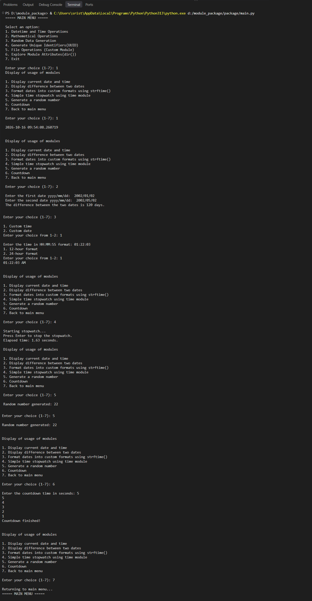

# 1. Modular Package

**A simple Python project that performs datetime operations, mathematical calculations, random data generation, UUID generation, file handling, and module exploration using custom Python modules.**

---

## 2. Project Structure

```
module_package/
├── package/             
│   ├── math_utils.py       
│   ├── explore_module.py   
│   └── file_operation.py   
├── main.py
├──output.png
└── README.md
```

---

## 3. Project Description

This is a console-based Python application that demonstrates how to use Python's built-in modules (`datetime`, `time`, `math`, `random`, `uuid`) together with custom modules organised in a package. The user works through a main menu and several submenus, so each module can be tried out interactively. The project also shows how to split a program into separate files and import them into a single entry point (`main.py`).

---

## 4. Features

### Datetime and Time Operations
- Display the current date and time
- Calculate the difference between two dates (`yyyy/mm/dd`)
- Format a time into 12-hour or 24-hour format using `strftime()`
- Simple stopwatch using the `time` module
- Generate a random number
- Countdown timer

### Mathematical Operations
- Factorial of a number
- Compound interest calculation
- Trigonometric calculations (sine, cosine, tangent)
- Area of geometric shapes (circle, square, rectangle, triangle)

### Random Data Generation
- Random number
- Random list of a chosen size
- Random password of a chosen length
- Random OTP of a chosen length

### Unique Identifiers (UUID)
- Generate a unique ID using `uuid.uuid4()`

### File Operations (Custom Module)
- Create a new file
- Add an entry to a file
- Read a file
- Append the filename to a file

### Explore Module Attributes
- View the contents of the `datetime`, `time`, `math`, `random` and `uuid` modules using `dir()`

---

## 5. Technologies Used


| Software / Tool | Purpose |
|---|---|
| Python 3.13 | Programming language used to build the project |
| Visual Studio Code (VS Code) | Code editor used to write and run the program |
| PowerShell (VS Code Terminal) | Running the program and viewing the output |
| Git | Version control to track changes in the project |
| GitHub | Hosting the project online and sharing the code |
| Windows | Operating system used for development |


---

## 6. Core Concepts Implemented

- Importing and using built-in modules
- Creating custom modules and organising them into a package
- Importing functions from one module into another
- Dates and times with `strftime()` and `strptime()`
- File handling (create, write, append, read) using `with open()`
- Exception handling (`FileNotFoundError`)
- Menu-driven programs using `while` loops and `if / elif / else`
- Input validation using `isdigit()`
- Inspecting modules with `dir()`
- Functions and f-string formatting

---

## 7. How to Run / Installation

### Prerequisites
- Python 3.x installed (this project was built with Python 3.13)
- No external libraries are needed, as only the standard library is used

### Steps

1. Download or clone the project folder:
   ```bash
   git clone <your-repository-link>
   ```
2. Open a terminal in the `module_package` folder:
   ```bash
   cd module_package
   ```
3. Run the program:
   ```bash
   python package/main.py
   ```
4. Enter a number from 1 to 7 to choose an option from the main menu and follow the on-screen prompts.

---

## 8. Output / Screenshots



---

## 9. Author

**[SRIJAN KUMAR MARUYA]**
